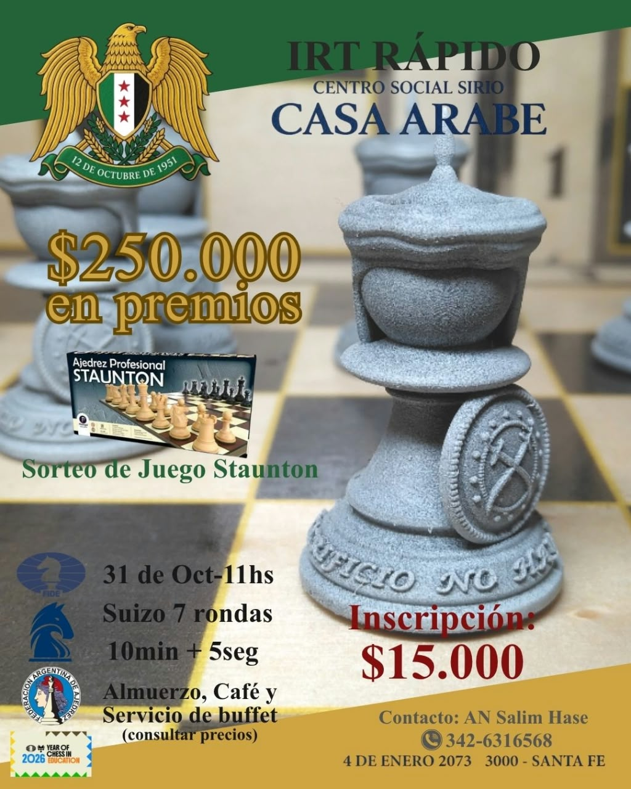

+++
date = '2026-10-31T11:00:00-03:00'
draft = false
title = 'Torneo de Ajedrez IRT Rápido "Casa Árabe"'
summary = 'Torneo de ajedrez rápido con rating FIDE: 7 rondas, 10 min + 5 seg y $250.000 en premios.'
+++

El Centro Social Sirio – Casa Árabe organiza el torneo **IRT Rápido "Casa Árabe" – Santa Fe 2026**, válido para rating internacional FIDE.

## Información

- **Fecha:** sábado 31 de octubre de 2026, 11:00 hs
- **Lugar:** Centro Social Sirio – Casa Árabe, 4 de Enero 2073, Santa Fe
- **Sistema:** suizo a 7 rondas
- **Ritmo de juego:** 10 minutos + 5 segundos por jugada
- **Rating:** Elo internacional FIDE (rápido)
- **Inscripción:** $15.000

## Premios

Total: **$250.000 en premios**

| Puesto | Premio |
|---|---|
| 1.º | $80.000 |
| 2.º | $50.000 |
| 3.º | $40.000 |
| 4.º | $30.000 |
| Mejor Sub-1600 y sin rating | $25.000 |
| Mejor juvenil | $25.000 |

Además, se sorteará un juego de ajedrez profesional Staunton entre los participantes.

## Servicios

Durante el torneo habrá almuerzo, café y servicio de buffet (consultar precios).

## Inscripciones y consultas

Los datos de contacto para inscripciones y consultas figuran en el flyer.

Jugadores inscriptos, emparejamientos y resultados en [Chess-Results](https://s1.chess-results.com/tnr1512472.aspx?lan=2&SNode=S0).
